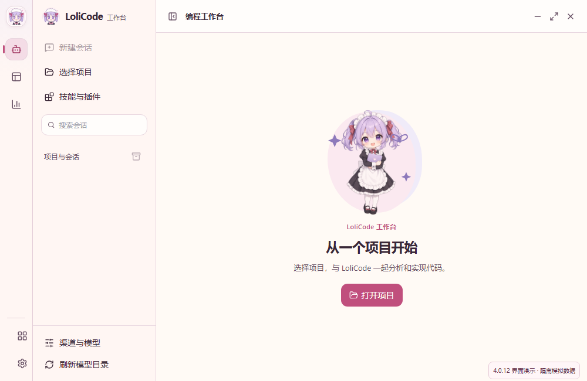
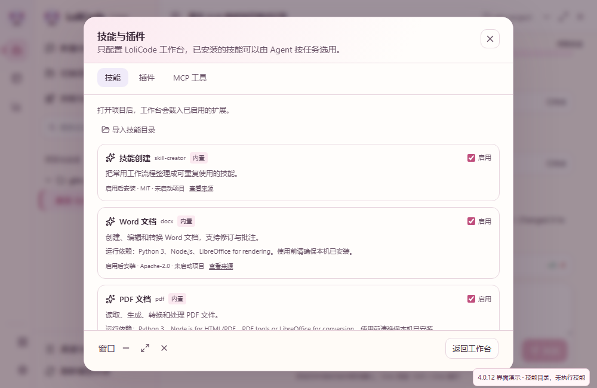

# LoliCode 编程工作台

LoliCode 将已有渠道与模型配置接到桌面 coding agent。选择项目、模型和“实现”或“分析”模式，输入任务即可开始。执行引擎使用固定版本 OpenCode；桌面界面和后续 CLI 通过同一套会话接口调用它。

4.0.12 使用奶油白、莓粉和薰衣草的女仆主题，支持对应深色模式。欢迎区展示透明吉祥物立绘，导航、聊天和桌面图标使用配套小头像。功能名称与代码、权限信息保持清晰。形象资源与生成提示词见 `src/assets/brand/README.md`。

## 使用

1. 在“渠道与模型”加入 API 或已支持聚合的订阅账号，保存需要使用的模型。
2. 进入“编程工作台”，选择本机项目文件夹。
3. 选择模型，使用“实现”模式修改代码，或使用“分析”模式先探索与规划。
4. 描述任务。文字实时更新，工具操作可以展开查看，实际文件改动从“查看改动”打开。
5. 在输入框下方选择“逐次确认”、Auto 或“完整访问”。工具需要权限或补充信息时，在当前会话内应答。“此项目记住授权”会保存到此项目。
6. 点击停止会请求引擎中断，界面等待真实终态；已经收到的内容保留。切换到渠道页不会停止后台任务。

项目会话保存在 LoliCode 自有数据目录中，可以重新打开并继续。项目与会话支持搜索、置顶，会话支持重命名、归档、恢复与删除；移出项目列表保留磁盘文件和引擎中的历史。未发送文本按项目和会话隔离保存在桌面会话缓存中。任务结束或停止后，输入框的模型选择器直接更新当前会话，后续消息使用新模型。实现/分析和权限模式同样写入真实引擎会话，执行中禁止切换。

同一私有引擎支持多个项目；切换项目、会话或渠道页面时，后台任务继续。渠道或扩展改动需要空闲后点击“刷新模型目录”/“重新载入”；存在后台任务时沿用该引擎已绑定的不可变目录。

“技能与插件”弹窗右上角提供关闭按钮，底部提供“返回工作台”，Esc 同样可以关闭；初始加载和保存等待都不会锁住关闭入口。Windows 与启用应用内窗口按钮的 Linux 在弹窗底部提供可访问的窗口操作，沿用原来的关闭到托盘设置。关闭弹窗不等于撤销已经提交的保存；重新打开时，旧请求不会覆盖新视图。

拒绝权限会结束本次任务，保留已收到的内容；同一会话可以继续发送新任务，应用重启也不会重新执行被拒绝的任务。模式切换的原生上下文提醒会留给下一次输入，不被当成后台任务。删除只检查目标会话和真实子会话，不阻止其他项目中的任务。

## 权限

默认“逐次确认”允许读取，修改与命令执行请求用户授权。Auto 自动允许项目内文件修改，并由宿主在后台批准明确的读取命令，例如 `node --version`、`git status --short`；检测使用原始工具输入与工作目录，重定向、管道、未知命令和执行项目脚本仍需要确认。此版本的 Auto 采用保守规则，不声称与 ZCode 的 guarded 策略完全相同。

“完整访问”需要用户在界面明确选择，允许该项目的写入与执行；访问外部目录和重复失败仍保留权限请求。“分析”强制拒绝文件修改、shell、子 agent 与未知插件/MCP 操作，即使之前选了完整访问。原生插件属于用户主动安装的程序，权限规则约束 agent 的工具调用，不对插件程序提供操作系统沙箱。

## 默认技能与扩展

内置并默认启用 ZCode 官方默认清单的五项技能：`skill-creator`、`docx`、`pdf`、`pptx`、`xlsx`。完整原文、脚本、参考文件及许可来自固定源码提交 `aac4755666d09fdcd70272fcf063c077a639015f`，每文件摘要见 `third-party/zcode/manifest.json`。入口在“技能与插件”，支持启停、使用技能、导入自己的技能目录，以及删除本地导入项。禁用项重新载入后从引擎目录移除；默认技能可以关闭，不删除随应用提供的资源。

默认清单以 [ZCode 官方插件定义](https://github.com/zai-org/ZCode/blob/aac4755666d09fdcd70272fcf063c077a639015f/apps/zcode-cli/packages/bootstrap/src/app/official-plugin-definitions.ts) 为依据。ZCode 的 [dynamic-workflows bundled skill](https://github.com/zai-org/ZCode/blob/aac4755666d09fdcd70272fcf063c077a639015f/apps/zcode-cli/packages/bundled-skills/README.md) 依赖它的专用 workflow 工具，此版本没有相应执行器，未假装接入。

技能随包提供内容，不自动安装它们所需的 Python、Node.js、LibreOffice、Poppler 或其他库。各项依赖在技能面板显示；文档生成、渲染与校验依赖本机环境。技能发现与真实激活单独验证，不将“已加载”当作文档转换全部通过。

扩展页支持真实 OpenCode v2 原生插件的本地文件/目录安装、启停和卸载，以及 MCP 服务器的新增、启停和删除。常用远程 MCP 使用名称、地址和可选 Token 表单，不要求编辑 JSON；敏感配置返回界面时遮蔽，保存未修改的遮蔽项保留真实凭据。配置“启用”与真实引擎“已载入/失败/待重新载入”分别显示。

ZCode 的 [UI Plugins / MCP Apps](https://github.com/zai-org/ZCode/blob/aac4755666d09fdcd70272fcf063c077a639015f/UI_PLUGIN.en.md) 包含 HTML 展示和宿主桥接协议，此版本提供 MCP 工具调用，尚未提供其内嵌应用展示宿主；也没有复制 ZCode 的插件市场。ZCode UI 插件不能直接作为 OpenCode 原生插件导入。

Git 项目提供引擎快照与文件 diff，需要本机可用的 Git。普通文件夹也可以聊天和读写文件，通过工具输出查看执行结果；项目是否初始化 Git 由用户决定。

Claude 和 Gemini 的原生订阅入口只供各自官方 CLI 使用，不能当作这个 agent 的可用模型。API、Copilot、ChatGPT、xAI、ZCode 渠道沿用统一网关的适配与凭据刷新逻辑，实际套餐权限仍由上游决定。

## 代码边界

- `crates/lolicode-agent/`：不依赖 Tauri 的执行引擎宿主、HTTP 会话调用、SSE 文字与工具事件、快照恢复和规范化 DTO。后续 CLI 复用这里，不重新写一套执行循环。
- `src-tauri/src/services/agent.rs`：桌面项目生命周期、会话所属项目校验和模型绑定。
- `src-tauri/src/services/agent_preferences.rs`、`agent_policy.rs`：持久项目/会话导航信息与 Auto 后台授权规则。
- `src-tauri/src/services/agent_extensions.rs`：私有扩展清单、敏感配置遮蔽、不可变版本投影与默认技能资源。
- `src-tauri/src/commands/agent.rs`：桌面 IPC。只返回无凭据的目录及会话数据。
- `src-tauri/src/services/channel_center.rs`：原目录的不可变版本、agent 私有配置投影及共享网关运行保护，不调用外部客户端配置写入器。
- `src/components/agent/` 与 `src/hooks/useAgentSnapshot.ts`：项目选择、聊天、执行状态、权限、问题与实际 diff 展示。
- `scripts/prepare-agent-runtime.mjs`：从锁定的 npm 平台包准备随应用分发的引擎与许可。

固定引擎为 `@opencode/cli` 2.0.12，对应 OpenCode 源码提交 `2670273ff17da96f85c5826ced57aa1b368754fa`。采用它的 V2 `/api/session` 合同，避免混用旧版 SDK 的 `/session` API。npm 包完整性由锁文件记录，资源清单记录实际二进制 SHA-256；这不是源码可复现构建证明。

引擎以独立子进程启动，监听本机临时端口并使用每次启动生成的认证密码。stdin 管道归宿主管理，应用退出时关闭执行引擎。配置、数据库、缓存、临时目录及 home 读取范围置于 LoliCode 自有目录；不导入用户另一个 OpenCode 实例的账号、配置或会话。短期上游凭据留在原认证管理器中，agent 配置只引用本地网关，聊天模型选择器不接收 Key。

流式文字来自真实 SSE 增量，持久消息与实际改动来自引擎快照。界面提交成功表示消息已入队，不能当作任务完成。连接中断会标明状态，恢复时重新读取持久快照。未来 CLI 复用引擎启动、会话、权限与中断接口；此轮交付桌面入口，尚未增加 CLI/TUI。

## 开源来源

实际随应用复用并分发的 agent 引擎是 [OpenCode v2.0.12](https://github.com/anomalyco/opencode/tree/2670273ff17da96f85c5826ced57aa1b368754fa)，许可为 MIT，完整许可在 `third-party/opencode/LICENSE` 与运行资源中。

ZCode 的五项默认技能随本版本分发，许可、原始来源和逐文件摘要见 `third-party/zcode/`。其他流程作为设计参考，并未同时整合它们的执行引擎：

- [ZCode 取消时保存流式内容](https://github.com/zai-org/ZCode/blob/aac4755666d09fdcd70272fcf063c077a639015f/apps/zcode-cli/packages/core/src/runtime/methods/cancelled-stream-persistence.ts)与[持久事件 reducer](https://github.com/zai-org/ZCode/blob/aac4755666d09fdcd70272fcf063c077a639015f/apps/zcode-cli/packages/contracts/src/events/event-reducer.ts)：保留中断前输出，等待真实结束事件，按持久状态恢复会话。
- [MiMo-Code 记忆路径](https://github.com/XiaomiMiMo/MiMo-Code/blob/e27e87de81a74db5475bd93540f8889dfbc70ec6/packages/cli/src/memory/paths.ts)与[checkpoint 布局](https://github.com/XiaomiMiMo/MiMo-Code/blob/e27e87de81a74db5475bd93540f8889dfbc70ec6/packages/cli/src/session/checkpoint-paths.ts)：项目身份与会话状态分开组织。LoliCode 本版提供项目会话隔离，尚未实现 MiMo 的记忆蒸馏或自我改进系统。
- [DeepSeek Harness 桌面与事件架构](https://github.com/deepseek-ai/deepseek-harness/blob/d743267388641bc76f17c45ce8b4c231aed1d32c/docs/architecture.md)与[生命周期清理](https://github.com/deepseek-ai/deepseek-harness/blob/d743267388641bc76f17c45ce8b4c231aed1d32c/docs/cordis-tutorial/02-lifecycle-and-effects.md)：固定运行时、宿主管生命周期，UI 消费协议。此轮保持模块边界，未引入 Cordis 插件系统。
- [Claude Code 的公开工作流](https://code.claude.com/docs/en/common-workflows)：项目上下文、分析/实现、测试结果、恢复会话与改动查看。官方 CLI 的[许可](https://github.com/anthropics/claude-code/blob/main/LICENSE.md)指向商业条款，此轮没有复制或分发其执行引擎。

## 验证

验证区分 UI 模拟接口、Rust 离线协议回归和固定真实引擎配合本机假模型的临时项目验证。示例截图不能作为真实上游授权或付费推理成功的证据。交付清单记录本轮实际执行的检查和产物校验值。

开发时先执行 `pnpm install` 与 `pnpm prepare:agent-runtime`。独立执行模块的回归用 `cargo test --manifest-path crates/lolicode-agent/Cargo.toml`；完整桌面回归用 `pnpm typecheck`、`pnpm test:unit` 与 `cargo test --manifest-path src-tauri/Cargo.toml --lib`。

真实引擎的离线临时项目检查：`cargo run --manifest-path src-tauri/Cargo.toml --example lolicode_agent_smoke`；扩展用 `cargo run --manifest-path src-tauri/Cargo.toml --features test-hooks --example lolicode_agent_extensions_smoke`，桌面行为用 `cargo run --manifest-path src-tauri/Cargo.toml --features test-hooks --example lolicode_agent_host_smoke`。需要明确授权的真实智谱测试使用 `cargo run --manifest-path src-tauri/Cargo.toml --features test-hooks --example lolicode_agent_glm_smoke -- --key-file <私有临时凭据文件的绝对路径> --out <脱敏结果文件的绝对路径>`。真实测试只操作自己创建的临时项目，经过生产渠道网关；不自动导入这份凭据到用户渠道配置。

Windows 安装包已包含 agent 运行资源。便携版须将 `LoliCode.exe` 与 `agent/` 文件夹放在一起，保留其中的二进制、许可和资源清单。

4.0.10 基线验证：前端 227 个文件、2726 项测试通过，桌面 Rust 后端 3666 项测试通过、10 项忽略，独立 Rust core 的 17 项回归通过。4.0.11 的检查结果另记在交付清单；安装包使用默认 features，`test-hooks` 仅为隔离验证增加测试入口。固定真实引擎配合本机假模型的原六项检查涵盖写文件、流式文字、实际 diff、分析模式拒写、真实中断与重启恢复。

4.0.11 验证：前端 229 个文件、2750 项测试通过，TypeScript 检查通过；桌面 Rust 全套 3677 项通过、10 项忽略，收尾后定向 agent 回归 50 项通过；独立 core 最终 34 项全部通过。真实引擎在自己的临时项目中验证了五项技能发现、原生技能激活、插件启动、MCP 实际调用与禁用重载，还验证了生产 IPC 的已载入标注。桌面宿主验证了 Auto 后台批准、未知 shell 人工确认、拒绝后继续聊天、Ask/Plan、当前模型与模式切换、导航信息持久化、删除与关闭，以及拒绝后同数据库重启不产生任何新的模型调用。上述本轮引擎检查使用本机假模型，不新增付费推理；截图中的 GLM 会话是下述历史真实结果的明确标注回放。

已使用用户授权的智谱凭据经生产渠道网关验证 `glm-5.3-flash`：真实读取并修改临时 Git 项目的 `sum.js`，将减法修成加法，Node 验证 `add(2,3) = 5` 和 `add(-2,3) = 1`，最终会话为 idle 且返回真实 diff。该凭据的通用 API 推理返回余额不足，Coding Plan 推理成功；本次仅验证此模型的推理与工具能力，模型目录读取成功不代表所有模型套餐权限都已验证。测试项目与执行进程已清理，临时凭据文件已删除，交付只包含脱敏记录与明确标注的界面回放。

4.0.12 验证：前端 230 个文件、2766 项测试通过，TypeScript 检查通过。关闭回归覆盖初始加载、保存、重载与迟到回复：关闭入口始终可用，跨重开周期的实际修改保持串行，未提交的迟到文件选择/配置读取不会再发起写入。浏览器检查确认 1000 × 650 欢迎页和技能弹窗、1280 × 940 浅深色聊天与 diff 均可读；X、Esc、底部返回、等待中关闭、焦点恢复及窗口关闭 IPC 调用通过。窗口动作使用隔离 mock，不是原生桌面运行截图；聊天截图回放之前的实际 GLM 记录，没有新增付费调用。该轮未改变 Rust 执行逻辑，后端行为验证沿用上面的 4.0.11 基线。
