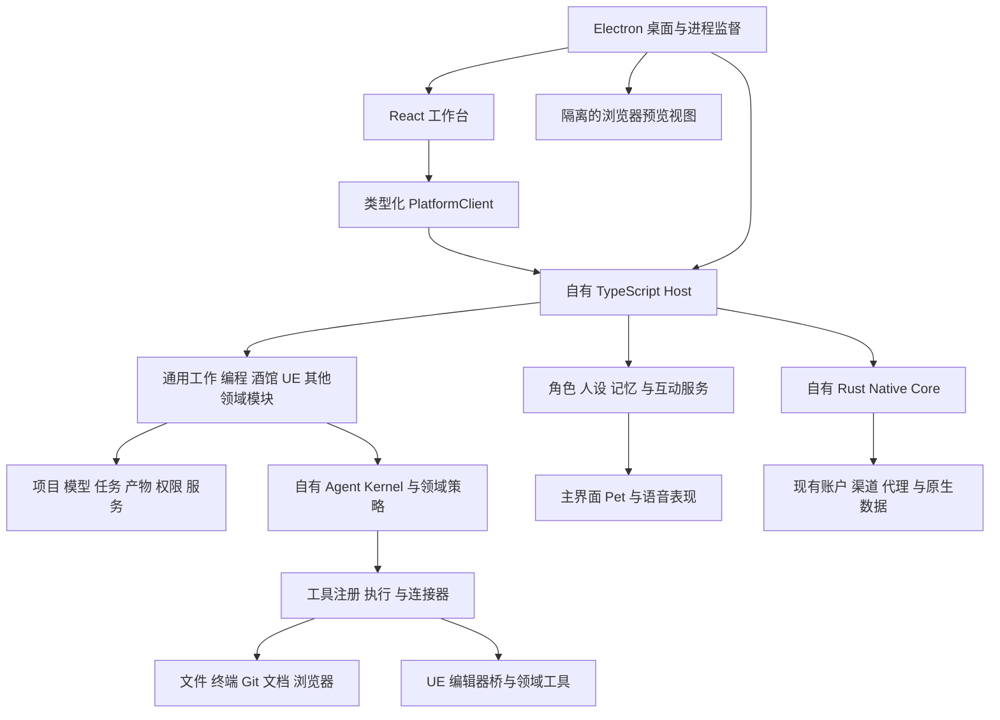

# LoliCode 桌面智能体平台架构对齐稿

日期：2026-10-15

状态：按“一个二次元美少女多功能 Agent、内置应用扩展、简单易用与强扩展性”推进；功能以实际验收为准。
本地核查基线：5de6efa7ba61e98e7f01a89526e75ac9eb337a0a，含当前未提交工作。

本稿替代上一版“完整运行时、完整伴随应用优先接入”的建议。上一版 OpenCode 程序适配实验已经暂停，未接入默认桌面流程，不属于本稿推荐架构。

## 1. 已经对齐的产品范围

产品优先覆盖 Windows、macOS、Linux 桌面，Web 暂不优先。我们拥有自己的界面、智能体、任务、模型入口和业务数据；从其他开源项目吸收具体功能、源码组件和必要依赖，允许第一方模块适度耦合。

产品定位与体验原则以[产品方向](lolicode-product-vision.md)为准。主角是具有二次元美少女形象、长期记忆与陪伴交互的多功能 Agent；应用中心是能力扩展入口。默认主 Agent 对话入口只有一个，不因添加应用而创建另一套 Agent 聊天窗口。角色形象、Pet 与未来语音共享同一主 Agent、任务与记忆服务。

智能体体验接近 WorkBuddy 的任务工作台：对话中规划与执行工具，右侧查看文件、差异、文档、网页和其他产物。WorkBuddy 只作为公开产品交互参考，不推断其内部架构或源码许可。[结果查看说明](https://www.workbuddy.cn/docs/workbuddy/Results)

不要求兼容 DSH 的 Cordis 插件、Profile 和整套生态，也不把 OpenCode、DSH、SillyTavern、UE Box 的完整程序作为功能交付单元。MCP、Skills、模型 API、角色卡等协议或格式可以按实际需要兼容。酒馆现成脚本与扩展的 DOM 兼容不作为当前默认承诺；相应业务能力仍保留在功能清单中。

未来范围包含通用办公和编程智能体、酒馆、UE 工程与资源管理、AI 操作 UE 编辑器，以及以后接入的其他领域。功能清单可以增加，架构不预先假定只存在这几种应用。

### 主 Agent 与应用工作台

用户可以直接进入主 Agent 对话；主 Agent 本身不需要通过应用中心添加。业务扩展采用类似飞书、钉钉的“应用目录 → 添加到我的应用 → 完成必要配置 → 打开业务工作区”路径。第一阶段只做内置业务应用，第三方网页与服务接入后置。未添加应用不向主 Agent 暴露应用专属工具；共享的基础文件、模型、任务能力不因此关闭。

“应用”包含独立业务页面、领域数据、工具集合、产物查看器、环境要求与配置向导。主 Agent 可以调用已启用应用暴露的工具，也可以带用户打开具体业务页面。一个领域模块可提供多个应用，同一个工具可以被多个应用复用；应用不拥有独立的主 Agent 对话。

内置应用候选包括工具配置、文档与知识库、酒馆、UE 工作台。目录只对实际交付的应用开放添加；未完成的能力标为规划中，不提供虚假的可用按钮。原有外部 CLI 安装与配置管理是工具配置应用中的业务能力，不等于已经支持添加任意第三方业务应用。

默认界面只展示目标、工作目录、模型来源和开始操作。高级页逐步展开模型原生参数、工具与 Skills、MCP、提示策略、路由、权限和诊断；高级功能继续保留，不在首次使用时全部铺开。

### 配置参考 CC Switch，并复用当前实现

本仓库已经基于 CC Switch 的固定快照发展，不需要另造一套供应商配置后台。来源为 farion1231/cc-switch@479964f2ef59e291f563218ac674a1fd82dcdbd3，原始来源和 MIT 声明见 FORK_BASELINE.md 与 LICENSE。复用供应商预设、导入与切换、MCP/Skills/提示词配置、备份恢复的既有实现，再为内部应用增加配置模板和能力检查。[上游项目](https://github.com/farion1231/cc-switch)

配置服务拥有模板、有效配置计算与迁移；账户密钥继续只存于凭据服务，应用保存引用。解析顺序为全局默认 → 应用覆盖 → 项目覆盖 → 本轮显式选择，启动任务时保存配置版本快照，不能在运行中因全局切换悄悄换模型或工具。

默认向导自动检测已有渠道和环境，使用推荐配置；只询问无法推断的必要项目。鉴权、依赖安装、选择工程等必要步骤仍真实呈现，不用“已配置”掩盖失败。检查结果区分未添加、待配置、检查中、可用、部分可用和已停用；故障可重试或修复，保留用户输入。

内部应用通过配置服务取有效配置；管理外部 CLI 时才通过对应适配器写目标文件。写入前保留原件和未管理字段，按文件安全替换，记录多文件部分成功状态并支持恢复，不承诺跨文件原子事务。

停用应用停止新任务与工具挂载；活动任务明确处理，仍可取消和读取结果。移除应用默认保留项目、会话、角色和产物；共享依赖只在没有其他使用者时释放。更新向导保留用户覆盖项，新增必填项进入待配置状态。

## 2. 推荐定下来的技术组合

**Electron + React/Vite + 自有 TypeScript Host + 现有 Rust Native Core。Host 内采用模块化单体，一个自有 Agent Kernel，按领域组合能力。**

Electron 负责窗口、托盘、更新、系统交互、浏览器视图与后台进程监督；React 延续当前组件和交互体系；TypeScript 承担新增智能体与领域编排；Rust 保留已有渠道、账户、代理和必要原生能力。

选择 Electron 的主要依据是三端桌面、内置浏览器预览与操作、Node 工具生态，以及新增功能主要适合 TypeScript。Electron 提供独立网页视图和 Node utility process，有助于形成统一的开发与调试路径。这是对本项目需求的工程判断，不是稳定性或模型效果的保证。[WebContentsView](https://www.electronjs.org/docs/latest/api/web-contents-view)、[进程模型](https://www.electronjs.org/docs/latest/tutorial/process-model)

Tauri 仍是可行路线：可打包我们自己的 Node Host，继续复用 Rust 桌面层。其 Windows 使用 WebView2，macOS 使用 WKWebView，Linux 使用 WebKitGTK，浏览器嵌入与自动化要处理不同后端；Electron 也仍需处理各系统的文件权限、凭据、系统交互和发行差异。[Tauri WebView](https://v2.tauri.app/reference/webview-versions/)、[伴随二进制](https://v2.tauri.app/develop/sidecar/)

本方案接受 Electron 的安装包与内存开销，以及现有 Tauri 系统接口迁移成本。先量测空闲、会话、多预览页、后台任务的资源占用，再确定发布预算。不会因为上游用了 Electron 就迁移它的完整桌面程序，也不会重写已有 React 页面、Rust 渠道实现。

过渡期保留 Tauri 可运行基线；新壳在账户、文件、托盘、更新和数据迁移达到验收条件后切换默认入口。切换后不长期维护两套完整产品。当前 Rust Agent 暂时继续支撑已有会话；新 Agent Kernel 达标后切换，新旧执行器不同时推进同一轮任务。

## 3. 应用内部的职责

### 桌面与工作台

左侧是项目、任务与模块入口；中间是对话、工具进度与任务操作；右侧是产物面板，支持文件、代码差异、文档、图像、网页等按需注册的查看器。这些是统一工作台里的视图，不是嵌入其他应用的完整 UI。

任务由 Host 持有，刷新 React 页面不终止任务；产物与任务通过持久 ID 关联，工具写出文件后可直接在侧栏打开。UE 管理、角色库等需要专用工作区时可以有独立 React 页面，不把所有业务强塞进聊天窗口。

浏览器预览有独立视图、会话和目标 ID。远端网页与可执行 HTML 产物不获得主界面的原生桥。浏览器工具操作同一个已绑定的预览目标，避免模型操作不可见的另一个页面。

### 自有 TypeScript Host

Host 内的第一方服务使用显式类型依赖，允许直接调用；不把每个业务模块做成微服务，不要求内部每次调用经过 HTTP 或通用事件总线。

推荐默认以 Electron utility process 运行 Host，业务包不导入 Electron。桌面适配层提供浏览器、系统对话框与进程控制。开发期可独立运行同一 Host，便于断点调试。CPU 密集任务、外部脚本和需要独立生命周期的连接器按需进入受管 worker 或子进程；进程分离本身不代表安全沙箱。

桌面首先采用带 schema 的 IPC/MessagePort 命令、查询和事件。PlatformClient 隔离传输细节；未来确有远程或 Web 需求再增加认证网络入口，不为未确定需求提前维护整套服务器产品。必要的大文件与终端流使用专用通道，事件中传引用，不塞大块二进制。

### 人设、记忆与表现服务

角色配置分离身份、人设、外观、声音与工作策略；替换形象或音色不创建另一个 Agent，也不重置项目和历史。二次元 UI、Pet、未来 2D/3D 角色和语音属于同一个 Agent 的表现与输入输出层，订阅实际任务状态，不自行启动第二套推理循环。

记忆服务区分用户偏好、Agent 长期经验、项目事实、领域知识与酒馆叙事记忆，按作用域检索并保留来源。提供查看、纠正、遗忘与导出入口。先支持本地持久化，再按实际需要适配可选记忆提供者；不能以一句“我记住了”代替真实写入回执。

Hermes 的内建持久记忆与可插拔记忆提供者作为研究候选；复用具体组件或适配提供者能力，不为接记忆运行完整 Hermes Agent。[持久记忆](https://hermes-agent.nousresearch.com/docs/user-guide/features/memory)、[记忆提供者扩展](https://hermes-agent.nousresearch.com/docs/developer-guide/memory-provider-plugin/)

语音输入、语音合成、流式播报、口型和表情通过稳定的交互事件与同一任务对齐。停止播报与取消任务分别处理；系统麦克风和音频设备权限按平台实现。具体形象 SDK、模型、音色和素材单独核查许可，不因代码开源就假定资源可复用。

### Rust Native Core

渠道中心、账户凭据、代理与现有数据继续由 Rust 实现拥有。先抽出不依赖 AppHandle 的服务，再通过我们自己的 Rust 服务进程暴露有限接口；第一阶段优先采用有版本和关联 ID 的本地管道/stdio 协议，避免增加 Node 原生扩展 ABI 绑定。

Rust 不再承接每个新增模块的业务编排；TypeScript 也不复制一套账户刷新、代理与凭据逻辑。框架相关通知和窗口逻辑留在桌面适配层。

### 模块与扩展

模块按功能归属组织，例如 file-tools、coding、tavern、unreal；来源记在来源清单中，不出现在平台核心协议里。

一个模块声明依赖服务，以及它贡献的页面、工具、产物查看器、连接器、领域提示策略和数据迁移。第一方模块直接组合；工具注册时校验 schema、执行目标、并发和资源冲突。具体注册 API 在第一条业务链打通后形成，不先造通用插件平台。

MCP 作为外部能力连接方式；Skills 作为可发现的指令和资源内容。两者都不等于兼容任意上游插件。配置变更与卸载要释放订阅、定时器、连接等资源。未来接入不可信可执行扩展时单独确定宿主和权限模型，不把它们默认加载进可信 Host。

## 4. 智能体与模型能力

### 一个自有内核，领域拥有自己的策略

Agent Kernel 负责轮次状态、模型流、工具调用、提问、取消、任务调度、上下文预算与恢复。编程模块提供项目指令、文件/Git 工具和编辑验证；通用办公模块提供文档、搜索、浏览器和产物生成；UE 模块提供领域工具、连接与验证。

酒馆可直接使用模型生成服务，也可按需接工具；角色扮演不强制经过编程 Agent 的规划与工具循环。世界书、角色记忆、群聊轮次与采样属于酒馆策略。跨模块共享基础服务，不自动混合角色世界记忆、代码项目上下文与 UE 会话。

智能体配置包含角色指令、模型偏好、工具范围、Skills、工作目录和权限策略。先做可复用智能体与主从任务；多 Agent 的并发、上下文隔离、资源锁与结果汇总由任务服务管理，不靠让几个聊天窗口互相转述实现。

### 把“满血”变成验收条件

公共消息使用有类型的内容块，供应商扩展使用有命名空间的类型，不把一切压成文本或丢弃未知字段：

- 按渠道能力选择模型协议，保留原生采样、推理开关和预算、工具选择、结构化输出、上下文限制等配置；不支持的配置明确报错或显示能力限制。
- 保留供应商要求的推理/签名、调用 ID、缓存标记、使用量、停止原因等往返信息；界面展示与后续模型请求分别处理。
- 图像、文件、音频等附件按协议传递；工具结果可携带结构化数据、图像和文件引用。大结果保留原文及定位信息，摘要不能覆盖原始结果。
- 工具 schema、并行语义、超时、错误、审批与取消均可追踪。只有不会冲突的操作才并发，编辑同一资源需协调。
- 压缩与裁剪按模型和任务策略控制；保留原始会话、摘要来源与压缩边界，溢出恢复不悄悄丢掉工具结果或附件。
- 渠道失败重试、模型切换和断线恢复不得自动重复已发生的写文件、提交、编辑器修改等副作用。未确认结果的操作先查询或标记待核对。
- 模型协议、工具能力和上下文策略分别做回归；以真实可交付任务验证完成率、成本和延迟。不能仅凭架构承诺所有模型性能相同。

Rust 网关只拥有路由、鉴权和既有渠道行为；Agent Host 拥有消息语义。实施时核查网关是否转换或过滤字段，必要时新增协议原样传输路径，避免 Host 支持了能力却被中间层截断。

## 5. 四个先落地的功能模块

### 通用工作与编程

优先形成“任务 → 读取资料/文件 → 调模型 → 执行工具 → 生成文件 → 侧栏预览 → 检查修改”的完整链路。包含文件读写与搜索、终端、Git diff、提问审批、浏览器、Skills、MCP、后台任务及子任务。

DSH、OpenCode、ZCode 共同作为 Agent 功能参考：综合比较工具、上下文、权限、任务与协作、会话恢复、预览与交互，然后形成一套自有实现和能力清单。具体优点必须由源码与任务验收证明，不把三个项目的执行循环同时拼入同一轮任务。按组件逐项提取或自主实现，依赖审计后决定采用哪些库，不承诺把上游私有内部 API 永久固定。

### 酒馆

以 SillyTavern 为主要功能与源码研究参考，RisuAI 补充研究角色表现与长对话记忆。已固定候选提交、许可、源码入口和第一条验收链路，见[酒馆主参考选择](lolicode-tavern-reference.md)。主参考选定不代表已采用源码或实现功能。

自有 React 角色库和聊天界面；兼容所选版本的角色卡、Persona、世界书、聊天历史与预设格式，保留未知字段和导入原件。世界书触发、顺序、预算、群聊、重生成、分支、采样需要独立回归。

原生提供脚本转换、正则规则、语音、图像和检索等必要业务能力；是否兼容特定第三方脚本，按具体需求评估并记录，不承诺 SillyTavern DOM 与任意扩展兼容。许可未定之前，不把 AGPL 源码合入共享内核。

### UE 工程与资源管理

引擎发现、工程导入、版本关联、插件管理、资源索引、下载与迁移、启动、编译和打包属于 UE 领域服务。资源 ID、工程信息与编辑器连接共享，不另做一套账户或任务平台。

区分跨平台管理能力与每个系统实际支持的引擎版本、编译工具链和插件；不能以桌面壳支持三端推定所有 UE 操作已经支持三端。

### UE 编辑器智能体

研究复用 UnrealAgentLink 的桥接实现与 UE Box 的领域工具、资源锁和回读验证。UE 插件是进入编辑器进程的必要连接部件，不是整套 UE Box 程序接入。

操作绑定工程、编辑器实例、连接代次和请求 ID；编辑器内操作在要求的线程执行。蓝图、材质、场景和 UMG 修改按操作执行编译、保存、读回等验证；失败返回结构化错误与证据。取消不等于撤销，重连不自动重复未确认的修改，撤销只能针对明确支持的操作。

## 6. 数据与稳定性

平台统一 Project、Conversation、Run、Artifact、AgentProfile、ToolCall 等标识和查询入口；各领域拥有自己的模型和表，不设计一个任意 JSON 大表包办所有功能。

Rust 保留现有账户、渠道与配置存储并作为唯一写入方；Host 为新增任务、智能体、领域数据建立自己的 SQLite 存储。统一数据归属不要求立即合并物理数据库。进程不能同时写入对方拥有的表，跨服务操作显式记录阶段和待恢复状态。

Host 的状态变更与事件/outbox 在同一事务落盘；事件用于刷新 UI，数据库状态用于恢复。重连先获取快照再按游标追事件；事件过期则重新同步。模型每个 token 不必各做一个完整持久事务，分块持久化和最终状态必须有顺序与中断语义。

数据库迁移有版本、备份和兼容检查；降级不能直接打开已升级为不兼容 schema 的生产库。开发实例使用独立数据目录和单写入锁，不能同时用 Tauri 和 Electron 写同一生产数据目录。

Host 崩溃后可以恢复任务信息，不等于可以无条件继续工具副作用。更新、休眠、关闭窗口、断网、权限拒绝与磁盘故障都进入恢复用例。原始模型请求诊断要脱敏，凭据不进入普通界面日志。

## 7. 开发与热重载

目标是改普通前后端代码不再制作安装包：

- React/Vite：界面 HMR；需要时刷新页面，Host 任务继续，页面重连恢复。
- TypeScript Host：watch 构建后受控重启或只重载支持安全释放的模块。活动任务先暂停/结束到明确边界，不承诺任意代码无损热替换。
- Electron main/preload：自动重启开发进程；系统接口变更需要进程重启。
- Rust Core：增量编译并重启对应服务；业务页面无须重新打包安装。
- UE 插件：按 UE 的 C++/模块规则编译，部分修改需要重启编辑器。

当前可以使用 pnpm dev 启动 Tauri 开发版；独立 Rust crate 的监听可使用 pnpm dev --additional-watch-folders ../crates/lolicode-agent。方案确认后再统一新开发入口与进程监督。前一版实验添加的 dev:platform 指向尚未编写的脚本，现已移除这一失效命令；平台实验仍可通过 pnpm build:platform 和 pnpm test:platform 验证。

## 8. 迁移顺序与放行条件

阶段 0：冻结产品边界与第一期清单，保留唯一主 Agent。前一版完整运行时适配实验不进入主线；产品方向见产品文档，实施验收见第一期计划。

阶段 1：在现有底座优先完善主 Agent：提问、回答、方向选择、真实思考/执行状态、工具进度、取消与恢复。打通模型、文件与终端、产物和预览；只改当前链路需要的交互，不先统一全局前端视觉。

阶段 2：接入 UE 与酒馆两个内置业务应用。应用提供业务页面、数据和领域工具，统一交给主 Agent 编排。源码与依赖许可逐项登记，第三方应用接入后置。

阶段 3：完成第一期验收。提问选择、状态、真实工具结果、应用添加/移除、UE 编辑器操作和酒馆数据与生成链路分别回归；仅登记实际通过的能力。整体 UI 风格统一、Pet、语音等不以假入口代替实现。

阶段 4：持续扩展记忆、通用工具、浏览器、MCP、Skills、子任务和后台工作，并按功能对等条件实施目标 Host、Rust 服务和 Electron 壳迁移。新旧会话保留执行器版本，同一轮由唯一执行器拥有；三端验证后切换默认入口。不让全量换壳阻塞第一期主线。

陪伴能力沿已确定的产品方向持续进入主线：人设、可管理的记忆、统一二次元界面、共享状态的 Pet，再到语音、口型与互动。整体视觉后续统一处理；后续第三方应用沿用应用边界，不改变主 Agent 唯一入口。

每阶段列出迁移前功能、预期行为、来源、许可、目标模块、回归用例与实际状态。完成标准是具体任务和数据行为达标，不能用“包已经引入”“程序已经启动”或“UI 看起来相似”替代。

## 9. 源码来源与许可处理

当前仓库声明 MIT；用户尚未决定最终产品许可。本稿只记录观察到的上游许可，不推断将来的发行形式。根目录许可不代表每个 vendored 文件、依赖库、模型、资源都相同，落地前按文件和依赖继续核查。

- DSH，571902028a75c64c1d767f4ae5fd099485f0ddf0，MIT。候选：工具、上下文、执行生命周期。复用代码保留版权与许可声明，不引入整套 Profile/Cordis 兼容承诺。[许可](https://github.com/deepseek-ai/deepseek-harness/blob/571902028a75c64c1d767f4ae5fd099485f0ddf0/LICENSE)、[架构](https://github.com/deepseek-ai/deepseek-harness/blob/571902028a75c64c1d767f4ae5fd099485f0ddf0/docs/architecture.md)
- OpenCode，3aa26f167660b46d61cbf44c52aa37c0a14bdc27，MIT。候选：模型协议、编程工具、权限与恢复组件；此源码快照不是已经选定的生产依赖版本。[许可](https://github.com/anomalyco/opencode/blob/3aa26f167660b46d61cbf44c52aa37c0a14bdc27/LICENSE)
- ZCode，aac4755666d09fdcd70272fcf063c077a639015f，Apache-2.0。候选：进程监督和任务体验；原有 runtime 子集与新的模块接入分别记录。[许可](https://github.com/zai-org/ZCode/blob/aac4755666d09fdcd70272fcf063c077a639015f/LICENSE)
- CC Switch，479964f2ef59e291f563218ac674a1fd82dcdbd3，MIT。当前仓库已有来源基线；配置、供应商、MCP、Skills、提示词和备份相关能力优先延续现有实现。现有复用与后续从上游提取的新文件分别记账。[来源基线](../../FORK_BASELINE.md)、[上游许可](https://github.com/farion1231/cc-switch/blob/479964f2ef59e291f563218ac674a1fd82dcdbd3/LICENSE)
- UE Box，ec65d7d1ae018944739d28cef18c78b4c53bca8f，根许可 Apache-2.0。本轮仅作流程与接口参考，没有集成 UEBox 程序代码。[许可](https://github.com/ueboxai/uebox/blob/ec65d7d1ae018944739d28cef18c78b4c53bca8f/LICENSE)
- 同一快照的 plugin/UnrealAgentLink 单独为 MIT。LoliCode 按需从固定提交下载该项目本地插件并保留 LICENSE；桌面应用没有打包这份插件源码。连接服务、配对认证、项目路由与 Agent 工具由 LoliCode 自己实现。[插件许可](https://github.com/ueboxai/uebox/blob/ec65d7d1ae018944739d28cef18c78b4c53bca8f/plugin/UnrealAgentLink/LICENSE)
- SillyTavern，06bde939fb1e9c4c8d8641d810f0a916b5bce127，AGPL-3.0。直接改编其代码可能对组合、分发与提供对应源代码产生要求；是否采用需先确定具体文件、组合方式与发行方案。格式兼容与源码复用分别登记。[许可](https://github.com/SillyTavern/SillyTavern/blob/06bde939fb1e9c4c8d8641d810f0a916b5bce127/LICENSE)
- WorkBuddy：只参考公开交互，不假定其代码开放，不复用其品牌、图标和专有资源。[公开结果区说明](https://www.workbuddy.cn/docs/workbuddy/Results)
- Hermes Agent，450ad5055eb3c4852d96676ee99287d618bd283a，根目录 MIT。候选为持久记忆、记忆提供者及相关服务设计；尚未采用源码，具体插件和依赖的许可需分别核查。[源码快照](https://github.com/NousResearch/hermes-agent/tree/450ad5055eb3c4852d96676ee99287d618bd283a)、[许可](https://github.com/NousResearch/hermes-agent/blob/450ad5055eb3c4852d96676ee99287d618bd283a/LICENSE)

每个复用单元记录仓库、commit、路径、文件许可、使用方式（设计参考/适配代码/库依赖/数据格式）、本地路径、修改摘要、直接与传递依赖、NOTICE 需求、验收用例及升级责任。新候选未落地时必须标为 candidate，不把计划当成已完成来源审计。

MIT 允许复制和改编代码，但仍要求保留适用声明；Apache-2.0 有相应分发条件。少复制、改名、改语言或加适配层都不自动消除原代码许可义务。直接满足许可条件的组件复用可以是正常路径，不需要为了“看起来没有 copy”而做机械改写。[MIT 文本](https://opensource.org/license/mit)、[Apache-2.0 文本](https://www.apache.org/licenses/LICENSE-2.0)

## 10. 本轮结论与仍需验证的事项

推荐冻结产品结构、技术职责、源码功能接入边界与迁移顺序。后续新增接入按“提供什么能力、属于哪个领域、数据谁拥有、执行发生在哪里、复用何种代码与许可”纳入同一结构。

Electron/Node 的精确版本、SQLite 驱动、要提取的上游文件集合、各系统最低版本和 UE 版本矩阵留给对应实现阶段通过真实制品验证，不把尚未验证的细节写成既定事实。

本轮没有切换默认桌面、替换 Agent 或迁移生产数据。前一版实验包与用户原有未提交工作均保留；功能清单中的 proposed 不表示当前产品已经拥有相应功能。
